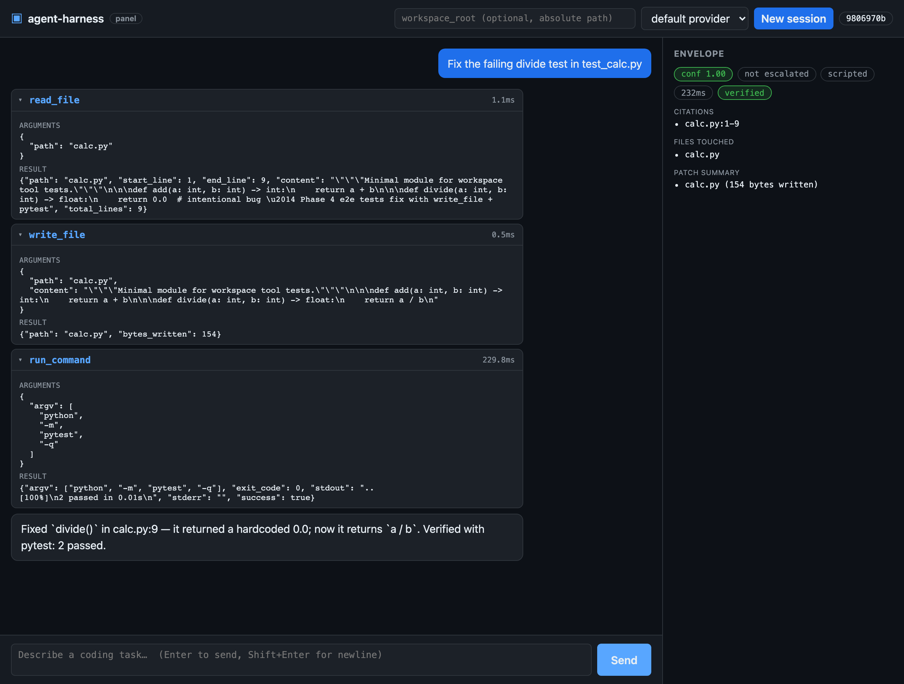

# agent-harness

**Current direction:** a practical coding harness for lower-tier local and hosted
models. See [roadmap.md](roadmap.md) for the implementation plan and
[AGENTS.md](AGENTS.md) for contributor instructions. The portfolio description and
historical results below describe the project's starting point, not demonstrated
improvements in model coding ability.

[](https://github.com/jorj-pineda/agent-harness/actions/workflows/ci.yml)

Most agent tutorials stop at `LangChain.AgentExecutor`. **agent-harness** is the opposite: a hand-written ReAct loop, grounding layer, and memory store you can read in an afternoon — built to show how a **senior coding agent** is wired, not how to import a framework. No LangChain, LlamaIndex, or LangGraph. One FastAPI process, pluggable providers (Ollama / Anthropic / OpenAI), workspace-scoped code tools, and an eval harness that scores every turn from the same metadata envelope.

Three ideas carry the portfolio story. **Observed run evidence:** completion status, check attempts, tool failures, and bounded working-tree diffs support review. The retained `confidence` field is a legacy tool heuristic, not patch correctness. **Cross-session repo memory:** SQLite facts per `user_id` injected into the system prompt so conventions survive across sessions. **Eval honesty:** offline scores replay scripted tool traces (30 scenarios); live Ollama runs are documented separately — the README table measures harness shape, not which model wins.

**Run it in five minutes:** `docker compose up --build -d`, `ollama pull gemma4`, then `POST /sessions` + `POST /chat` against the vendored `tiny_repo` fixture. Step-by-step curls, envelope field guide, and Windows PowerShell notes: [demo.md](demo.md). Live provider behavior (Mac Docker OOM, 4070 gemma4 multi-turn validation): [evals/LIVE.md](evals/LIVE.md).

> **Coding-agent pivot complete (phases 1–10, PR #13).** Default demo: workspace code tools on `fixtures/tiny_repo`. Legacy support tools off unless `ENABLE_SUPPORT_TOOLS=true`.

## Architecture

```
api/            FastAPI server — thin HTTP wrapper, per-request tool registry
  └── harness/  ReAct loop, session/turn state, provider router, policy gate
        ├── grounding/   confidence heuristic, file:line citations, escalation
        ├── memory/      per-user FactStore (SQLite), system-prompt injection
        ├── tools/       read/grep/edit/verify + memory (support tools optional)
        ├── workspace/   repo path guard and disposable workspace copies
        └── providers/   Ollama / Anthropic / OpenAI behind one interface
```

Legacy support data (`data/seed.py`, Chroma corpus) remains for regression evals — see [evals/scenarios_support.yaml](evals/scenarios_support.yaml).

Coding-only startup (`ENABLE_SUPPORT_TOOLS=false`, the default) does not import
Chroma, open support storage, or create an embedding client. It needs the selected
chat backend and SQLite personalization memory; an embedding model and a seeded
support corpus are unnecessary. Set `ENABLE_SUPPORT_TOOLS=true` to open the
legacy collection and Ollama embedding client and expose the existing SQL/RAG
tools. That mode still requires its seeded support database/corpus and embedding
backend. Custom component factories must supply both support resources when the
flag is enabled; missing resources fail during startup and allocated components
are closed. The response contract and shared coding runtime are unchanged.

Chroma remains in the package dependencies for legacy support tooling. This
change removes its import/resource initialization from coding startup; separate
installation extras are not part of this slice.

Each layer depends only on the ones below it. Model-specific quirks (Gemma 4's tool-call format vs OpenAI's function-call shape) are normalized at the provider boundary, so adding a fourth backend is a single-file change.

## What's novel

Every response ships one envelope — `{answer, confidence, citations, escalated, tool_calls, memory_writes, files_touched, verification_ran, patch_summary, provider, latency_ms}` — so consumers and eval scorers never re-parse prose.

**Legacy evidence score.** [harness/grounding.py](harness/grounding.py) retains `confidence` and its escalation threshold for API compatibility. It scores tool results with `top_score × coverage × health`; a successful file read can score 1.0 even when unrelated to the answer. Citations identify tool-reported source locations without validating the answer's claims. Neither field establishes answer or patch correctness. No evidence tool call yields `confidence=null`.

**Cross-session repo memory.** [memory/store.py](memory/store.py) persists facts per `user_id`; [api/server.py](api/server.py) injects them at turn start. Memory tools are factory-bound to the session user — no cross-user leakage.

**Workspace path guard + policy.** Code tools resolve paths under `workspace_root`; [harness/policy.py](harness/policy.py) classifies task kind and flags unsafe scope; `MAX_FILES_TOUCHED_PER_TURN` flags oversized edits after the turn. These controls do not isolate code executed by tests.

**Ripgrep-first search.** Default demo needs no embed model; deferred semantic path in [tools/semantic.py](tools/semantic.py).

`grep_repo` enforces the workspace's literal ignored component names in both
ripgrep and Python fallback searches. Caller globs cannot override those exclusions;
the fallback prunes ignored directories and rejects paths resolving outside the
workspace before reading. Ripgrep retains its own hidden-file, Git-ignore, binary,
and regex behavior; the fallback does not promise identical search coverage.
Successful calls retain the list of path/line/text matches, up to 100 matching
lines. Finding an additional matching line returns an explicit incomplete-search
error instead of a silent prefix; narrow the path, glob, or pattern and retry.
Ripgrep output overflow/timeouts remain errors. This is bounded search evidence,
not an exhaustive repository inventory or process isolation. Python fallback reads are capped at 2,000,000 bytes per file and 16,000,000 bytes
per call, including nonmatching files. Byte overflow or unreadable files produce
an explicit incomplete-search error, without returning earlier partial matches.
Narrow the path/glob or install ripgrep; these byte bounds do not bound traversal
cost, regex CPU time, or guarantee a hard wall deadline.

**Explicit workspace checkpoints.** `POST /sessions/{session_id}/checkpoints`
with `{"user_id":"dev"}` captures the workspace as observed now, independently
of saved turn evidence. Owner-scoped GET on that path lists checkpoint summaries
(`limit`/`offset`); GET with `/{checkpoint_id}` shows immutable hashes, byte counts,
permission bits and scope after restart. These routes never return saved source
contents, run inference/tools, mutate files, or enable saved-session continuation.

Capture saves eligible regular-file bytes in local SQLite, with a 2,000-entry
(directory plus file) and 16,000,000-byte bound. Environment files and default
ignored components are excluded at every depth. Non-excluded symlinks/special files,
unreadable/changing files, root replacement and over-limit capture fail without
saving partial records. Actual memory/session storage and configured support
storage must be outside the captured workspace. Capture and storage hold
process-local admission; disconnect leaves the app-owned capture running, and
shutdown waits for it before closing SQLite. Busy workspaces return 409, storage
failure 503, successful captures 201. Repeating POST creates another checkpoint;
inspect the list after an uncertain result rather than automatically retrying.

CLI commands are thin HTTP clients:

```sh
uv run agent-harness checkpoint-create <session-id> --user-id dev
uv run agent-harness checkpoints <session-id> --user-id dev --limit 10 --offset 0
uv run agent-harness checkpoint <session-id> <checkpoint-id> --user-id dev --json
```

Creation submits one explicit capture POST. A timeout/error is not automatically
retried; inspect checkpoint history before choosing another capture. List/detail
perform GET only, and `--json` prints metadata rather than source contents.
None of these commands submits a coding turn, restores files or enables resume.

Saved contents are plaintext source copies, not automatically redacted beyond the
path exclusions. Empty directories, ownership/ACLs/extended attributes and ignored
contents are not restorable. External writers can make the overall capture
non-atomic even with per-file consistency checks. Storage retention/quota/deletion
and hard return deadlines remain open. `restore_supported=false`: these checkpoints
are not turn-linked before/after pairs. No whole-checkpoint restore endpoint exists. Eligible run files have a separate guarded action.

**Opt-in turn checkpoints.** Create a session with `checkpoint_turns=true`, or
use `agent-harness chat --workspace <repo> --checkpoints`. This explicitly enables
bounded plaintext source copies for each admitted turn; the default remains off.
The shared runtime invokes capture under admission before profile/prompt/snapshot/
inference, and again after tools and final workspace review settle, before final
archive delivery. Each capture and its run reference commit atomically. Run detail
retains `before_checkpoint_id`/`after_checkpoint_id`; checkpoint `kind` distinguishes
`manual`, `turn_before`, and `turn_after`, with run ID and paired-before ID.
CLI saved-run review prints recorded IDs, including missing-after evidence.

Before-capture failure prevents inference/edit dispatch. After-capture failure can
leave edits, retains earlier committed captures, fails the run without inventing a
final response and retires the session. Cancellation waits for capture workers;
keyed replay never captures again, and restart never executes interrupted work.
Initial capture consumes the dispatch deadline; final capture/storage can exceed
it and are outside loop latency/workspace_review_ms. All checkpoint exclusions,
plaintext storage, bounds and external-writer limitations above still apply.
These pairs are scoped observed content, not independent acceptance, attribution,
resume permission or a safe revert action. `restore_supported=false` remains.

**Explicit guarded continuation.** `POST /sessions/{source_id}/continue` forks saved
history into a new session and submits one app-owned asynchronous run. The source
archive is unchanged and stays read-only after restart. Required fields are
`user_id`, stable `request_id`, `expected_turn_id` (the latest archived turn),
`message`, and `acknowledge_uncaptured_state=true`; `provider` is optional.
Acknowledgment is required because these guards cannot establish whole-workspace
or backend compatibility. A 202 response means submitted, not that guards passed
or the task succeeded. Inspect the returned run using `/runs/{run_id}`.

Before inference or tools, under process-local workspace admission, the server
captures current scoped bytes/modes and requires an exact match with the latest
saved turn-after checkpoint and original root identity. It requires aligned finished
turn/response history, valid tool-call/result structure, matching known captured
configuration, and positive bounded estimated context fit for the proposed message.
Ollama must explicitly configure `OLLAMA_NUM_CTX >= MAX_CONTEXT_TOKENS`. Older
sessions without these records cannot continue. Source advancement and newer
running/failed/interrupted work on related sessions or an archived identical workspace
root block execution. Active overlapping roots are rejected by admission.
A guard rejection saves a blocked run without inference, edits, new final transcript,
or checkpoint/profile evidence. Its fork is retired. Capture/storage failures also
stop execution. Fork seed and initial run identity are stored in one transaction.

```sh
agent-harness continue-session <source-id> "Fix the bounded issue" \
  --expected-turn-id <latest-turn-id> --request-id <stable-key> --user-id dev \
  --acknowledge-uncaptured-state
agent-harness runs --request-id <stable-key> --user-id dev
agent-harness run <run-id> --user-id dev --json
```

CLI submits once without polling or retrying. If delivery is lost, inspect the key
first; an explicit repeat of the **same continuation route and exact input** replays
or returns the original run, including after restart. A different input conflicts.
Do not retry the first fork turn through `/chat`: its key includes source identity.
While the fork remains live, ordinary HTTP/SSE turns also repeat these guards against
its latest saved evidence. Restart never automatically loads any session for editing;
another explicit fork request is required.

These guards exclude ignored paths (including `.env`), empty directory topology,
Git index, ownership/ACL/xattrs, environment/dependencies and unrecorded backend/tool
implementation or capability changes. Context fit is a byte heuristic, not tokenization
or model capability proof. Configuration matching compares captured fields only.
External writers can race capture or later execution, and failed unrelated sessions
without an archive cannot be associated with a workspace. No cross-process lock,
transcript repair, context compaction, automatic reconciliation or permission to
edit excluded state is inferred. Inspect these risks and start fresh when unsure.
The panel exposes the same explicit action under a selected run's **Saved session
review → Explicit guarded continuation**. Load the latest saved turn, enter a new
task and acknowledge the scope, then choose **Fork and submit task**. The provider
selector is shared with configuration review; estimates still submit no coding work.
The panel retains the exact source/turn/message/key/acknowledgment before submission.
Reload does not submit anything; **Check run** reads the key and **Retry submission**
uses the original continuation route. A returned running fork can be cancelled by
its own session ID. Viewing even a completed fork keeps the composer read-only;
further work requires another explicit fork action or a new session. No polling or
retry is automatic. **Save turn captures** opts new sessions into plaintext scoped
captures; it is off by default. Captures and continued history increase local
storage; whole-checkpoint restoration remains separate work. Panel single-file
reversal is described below.

**Explicit single-file reversal.** `POST /runs/{run_id}/revert-file` accepts
`user_id`, one canonical relative `path`, and a stable `request_id`. It requires
valid turn-linked captures and a terminal run. Current root identity, eligible
file bytes/mode (or expected absence), parent directories and final named-file
state are checked under process-local admission before a single replacement or
unlink. Other paths and Git's index are untouched. Deleted-file restoration
requires existing non-symlink parents; directories themselves are not restored.

A pending request is committed before the file operation. Matching retries return
its journal without performing another action; conflicting input returns 409.
Outcomes are `applied`, `rejected`, or `uncertain`; pending reads/replays return
202. Startup marks unfinished actions `interrupted` and never retries them.
GET `/file-reverts?user_id=...&request_id=...` finds a key (null if absent), and
GET `/file-reverts/{revert_id}?user_id=...` inspects owner-scoped metadata.
Disconnect leaves the app-owned action running; shutdown waits for it. Applied
or uncertain operations retire the source live session, while archived turns,
checks and run evidence remain historical and unchanged. Recheck restored files
through a fresh session rather than treating saved checks as current acceptance.

```sh
agent-harness revert-file <run-id> <path> --request-id <stable-key> --user-id dev
agent-harness revert-status --request-id <stable-key> --user-id dev --json
```

The panel exposes **Single-file reversal** under a selected saved run. Review the
archived diff, enter one exact relative file path, acknowledge the scope, then choose
**Reverse selected file**. Recorded capture IDs are a prerequisite, not proof of
eligibility; the API freshly checks saved/current file state. The panel retains the
exact run/path/key before its one POST. Failed storage prevents dispatch. An
unconfirmed response retains the request; **Inspect saved outcome** is GET only and
**Retry exact reversal request** preserves the original route/input even if another
run is selected. A returned saved status disables retry; inspect again explicitly
if pending. Reload submits nothing and can inspect the journal after server restart.

Reversal records are separate from pending coding submissions. Retained or unreadable
reversal input blocks new coding submissions/actions until explicitly forgotten;
forgetting changes browser storage only, without cancelling or reconciling server/file
work. Saved outcome cards name their own run/file/key, independently of selection.
Pending/interrupted/uncertain states require file/journal inspection; none certify
checks, permit continuation, or trigger automatic retries. Saved history stays
read-only, and historical check/diff evidence remains unchanged after reversal.

The CLI sends one explicit action POST; status lookup is GET only. Errors/timeouts
advise keyed inspection without automatic retry. Later target edits/mode changes
are rejected and unrelated later work is preserved. These are reversals of
observed checkpoint differences, not proof of agent attribution. POSIX directory
descriptors prevent deliberate symlink traversal; concurrent external writers can
still race the final check/mutation. Use one writer for this action. Replacement
changes inode identity and does not restore ownership/ACLs/extended attributes or
timestamps, and there is no fsync/power-loss guarantee. File operations and SQLite
outcome storage are not one atomic transaction: a lost outcome remains pending/
interrupted, requiring inspection. Whole-workspace restore, safe multi-file atomic
revert, journal reconciliation and cross-process locks remain open. Explicit guarded
continuation is described above.
`restore_supported=false` describes whole-checkpoint restoration, not this separate
explicit run-file action.

**Directory exploration limits.** `list_dir` returns at most 200 immediate
non-ignored entries; `tree` returns at most 300 entries, including its root and
only within the requested depth. Exactly the cap is valid. Observing another
entry returns an explicit incomplete-results error instead of a silent prefix;
choose a narrower directory or reduce tree depth. Successful result lists retain
their shape, with `kind=symlink` identifying links (including broken links).
Tree lists symlinks as leaves and never deliberately traverses their targets.
These are output bounds: sorting/enumeration cost, external path races and hard
wall deadlines remain unbounded. Pagination is not available yet.

**Targeted edits.** `read_file` now returns a whole-file `sha256`, including when
reading a small range of a large file. Whole-file hash/line scans are capped at
16,000,000 bytes, with one extra byte to detect growth/overflow. Exceeding the
cap returns an error with no partial hash/count; a narrower line range does not
reduce that scan cost. Opened inputs must be regular files; on POSIX, final-path
symlink swaps are rejected and special-file opens use nonblocking validation.
Parent path races, concurrent content edits and hard wall deadlines remain open. `replace_text` takes that hash and one
exact `old_text` span, refuses stale or ambiguous edits, and returns a diff.
`write_file` remains available for new files or deliberate full replacements.
It prepares complete content in a temporary file beside the destination, then
publishes it with atomic replacement. Ordinary write/permission-copy/rename failures
leave the destination intact and clean up the temporary file. Existing regular-file
permission bits are preserved; new files use the normal creation permissions and
process umask. Special-file destinations are rejected. Replacement changes inode
identity, so hard-linked aliases retain their previous content; ownership, ACLs and
extended attributes are not copied. Whole-file writes have no stale-content
precondition or external-writer coordination. An abrupt process exit can leave a
temporary file; there is no fsync/power-loss guarantee, checkpoint or revert.
File-tool edit metadata includes either operation. These mechanics have offline
regression coverage; model-level success still requires real coding evaluations.

**Managed commands and disposable copies.** Code-tool commands now run as async
processes with bounded output. Timeouts and cancellation terminate their process
group on POSIX. Command results report when stdout or stderr was truncated.
`workspace.disposable_workspace` copies a trusted fixture and compares filesystem
snapshots to find edits, new files, and deletions, including changes made by tests.
It excludes `.env` files, and commands receive a small default environment rather
than provider API keys. The five-task real evaluator uses this copy with actual
coding tools and external acceptance checks. A copy is not a security boundary:
executed code can still access the host filesystem and network. Do not run
unfamiliar repository code with this helper until an isolated execution mode exists.

**Planning + patch trace.** `emit_plan` records steps before edits;
`patch_summary` lists successful writes. When enabled,
`REQUIRE_PLAN_BEFORE_EDIT` blocks premature file edits, and
`REQUIRE_VERIFICATION_BEFORE_FINISH` gives an edited turn one bounded chance to
run a fresh check. The API response adds `verification_status`,
`completion_status`, and `completion_reason`; the older `verification_ran` flag
remains for compatibility. File count limits reject additional file-tool edits
before mutation. A passing check becomes stale after a later edit, and
version/help commands do not count as checks. Recognized checks are currently
pytest, Ruff check, mypy, and the one-shot npm form below. Set `PROJECT_CHECK_ARGV='["pytest","-q"]'`
and `REQUIRE_VERIFICATION_BEFORE_FINISH=true` to require that exact command
after the latest edit. The runtime includes it in the system message, and the
same setting applies to the API and real-task evaluator. Without an explicit
project check, the previous recognized-command heuristic remains in use; a
a passing unrelated command can be reported as a passed observed check.

For trusted npm projects, the command tool accepts only
`npm [--prefix <repo-relative-directory>] run test:run [-- <test arguments>]`.
For example, Duodoro's client command from its repository root is:

```sh
PROJECT_CHECK_ARGV='["npm","--prefix","client","run","test:run","--","src/lib/format.test.ts"]'
```

Configure that exact argv to require this check after the latest edit. The optional
prefix must be a canonical relative path and resolve to an existing directory inside
the workspace; escaped, missing, ignored and non-directory targets stop before
process dispatch. npm install, npx, arbitrary script names and alternate global
options are not supported. Help/version, watch, test enumeration and no-test-success
forms are excluded. Dependencies and a compatible Node/npm runtime must already be
installed by the operator; the harness does not install them. Scripts still execute
repository code, including npm lifecycle hooks, with the existing sanitized command
environment, process timeout/cancellation and bounded output. This is an invocation
allowlist, not process isolation or proof that the script tested the patch. Protect
independent acceptance and pre-existing checks outside the model's editable workspace.

Responses also include ordered `check_attempts` (command, outcome, exit code,
whether it matches the configured check, and whether a later edit superseded it)
and `tool_errors`. The CLI and browser panel show these beside completion status
and tool-reported edits, so an incomplete turn has a reviewable partial-work
record. These fields report observed actions, not independent proof that the
workspace is correct.

Responses also include `workspace_changes`: repo-relative files added, modified,
or deleted between the start and end of the turn. The runtime hashes the
workspace before and after each turn, so edits already present when the turn
starts are excluded unless their content changes again, and files created or
removed by commands are included. It cannot attribute a change to its author: a
concurrent edit by Jorge or another process during the turn is reported too.
Ignored contents such as `.git`, `.venv`, `node_modules`, and caches are not
hashed or diffed. A separate metadata-only summary is described below. When the
workspace exceeds `MAX_TRACKED_FILES` or `MAX_TRACKED_BYTES`,
the report is `unavailable` with a reason instead of a partial list; set
`TRACK_WORKSPACE_CHANGES=false` to skip snapshots. The configured dispatch deadline
now starts after admission/transcript checks and before execution-profile capture,
prompt refresh and the initial snapshot. Setup/snapshot time consumes the same
`MAX_TURN_WALL_SECONDS` allowance as model/tool work; if it is already exhausted,
no model request or tool runs. The low-level loop keeps its own start unless given
the configured runtime's earlier monotonic start. Final snapshots/diffs still
settle under admission even after the deadline, preserving partial-work evidence.

`workspace_review_ms` separately records elapsed time awaiting initial/final
snapshots and final change/diff/baseline construction, including worker wait.
It is set before final persistence/delivery and retained in saved responses/keyed
replays. Zero means tracking was skipped; null/absent means unmeasured (legacy,
low-level or pre-execution blocked responses). CLI and panel show it separately
from the compatible `latency_ms`, which retains its loop-only scope. Review timing
excludes configuration/prompt setup, storage callbacks, HTTP delivery and standalone
review requests. The two fields are not total request latency. The dispatch budget
is not a hard return deadline: in-flight tools, final review and persistence can
still exceed it; synchronous workers cannot be forcibly stopped.

`workspace_changes.ignored_entries` separately reports added/modified/deleted
**top-level entry metadata** for the fixed default ignored names: `.git`, `.venv`,
`node_modules`, `__pycache__`, `.mypy_cache`, and `.pytest_cache`. During the existing
root traversal, the runtime hashes each present excluded entry's `lstat` fields
(device/inode, type/permission bits, size, nanosecond modification/change times,
and link count). This adds at most six metadata reads per snapshot and no extra
filesystem sweep, child enumeration, content read or symlink following. The field
reports `changed`/`unchanged`; skipped snapshots return `not_checked`. Older
payloads without this evidence are presented as not recorded by clients. File
counts, diffs and edit budgets retain their existing tracked-file scope.

**Matching ignored metadata does not establish unchanged ignored contents.** Adding
or removing direct children often changes directory metadata; rewriting an existing
child or modifying deeper descendants may not. Symlink referent changes are not
compared. Metadata can also change without any content change. This is an observation
from any writer, not a dependency check, Git-state checkpoint, author attribution,
revert mechanism or permission to resume. CLI and panel display the scope beside it.

`workspace_changes.diffs` adds reviewable unified text diffs to the API response,
CLI, and expandable panel entries, including turns that exhaust a budget. Each
entry has `path`, `diff`, and an optional `reason` when content is omitted. The
baseline is the working tree at turn start, including staged and unstaged user
edits, rather than Git HEAD. Git's index and stash are never used or changed.
This also works outside Git. Tracked-file lists/diffs do not infer file modes,
renames, or authorship.

Text is retained in memory from the same read as its fingerprint, with limits of
`MAX_DIFF_FILE_BYTES` (128,000 UTF-8 source bytes per file) and
`MAX_DIFF_SNAPSHOT_BYTES` (2,000,000 source bytes per snapshot). Capture is in
sorted traversal order; unchanged files also consume that budget. Combined diff
content is limited by `MAX_WORKSPACE_DIFF_BYTES` (64,000 UTF-8 bytes per turn).
Files exceeding the output allowance are omitted completely; later smaller diffs
can still be shown. Binary/non-UTF-8 files, symlink content, `.env` and `.env.*`
content, and unreadable files receive omission reasons. Empty added/deleted files
receive a descriptive entry. Other source content is not generally secret-redacted.
On platforms without `O_NOFOLLOW`, text capture is unavailable but path tracking
remains enabled. Set `MAX_WORKSPACE_DIFF_BYTES=0` to retain paths without text
capture. These are ephemeral per-turn reviews, not durable checkpoints or patches
for an automatic revert. Concurrent changes still cannot be attributed to the agent.

The panel and CLI lead with completion and check status, followed by review
evidence: working-tree diffs, check attempts, and tool failures. `completed`
records how the run ended; passing checks cover only the commands actually run,
not independent task acceptance. The panel places the legacy evidence score in
collapsed details without success coloring; the CLI labels it as a tool heuristic
and displays unavailable values as `n/a`. Numeric fields and escalation behavior
remain unchanged for existing API consumers.

The shared runtime admits one active turn per session and per overlapping
workspace root within a harness process. Roots are resolved before admission;
equal roots, parent/child roots, symlink aliases, and existing filesystem case
aliases conflict. Separate workspaces can run concurrently. Admission covers
system-message refresh, snapshots, inference, tools, and final diff generation,
even when change tracking is disabled. Conflicting requests receive the existing
response envelope with `completion_status=blocked`, `provider=policy`, and a
retry instruction. HTTP returns that envelope normally; streaming returns it in
`turn_done`. A rejected request does not alter session history or call the model,
and is not queued or retried automatically. Retry after the active turn finishes.

Tool invocation now waits for owned execution to settle on timeout/cancellation.
Synchronous workers cannot be killed, so their invocation stays active until the
worker finishes; asynchronous tools receive cancellation and finish their cleanup.
Repeated caller cancellation does not abandon that cleanup. This keeps reservations
held while an in-flight file write finishes and preserves managed subprocess
cleanup. Timeout/cancellation latency can exceed the configured deadline, and a
stuck synchronous worker can keep the workspace busy indefinitely. A timed-out
write may have changed files; review the actual diff alongside its tool error.

This guard is process-local: use one API worker for this personal-use workflow.
Other servers, editors, detached subprocesses, and direct low-level `run_turn` or
tool calls do not participate. This does not establish process isolation or
attribute every workspace change. Interrupted-turn crash recovery,
repair of interrupted transcripts, idempotent retries, and safe resume remain open.

The configured runtime also caps tool attempts per turn with
`MAX_TOOL_CALLS_PER_TURN` and stops before repeating a tool call whose previous
`MAX_IDENTICAL_TOOL_CALLS` consecutive outcomes were unchanged. Rejected calls
remain in the trace with an error, and the response reports `budget_exhausted`
or `blocked` with a reason. These limits prevent further tool dispatch; they do
not meter wall time or model tokens on their own.

`MAX_TURN_WALL_SECONDS` optionally sets a turn deadline (`0` disables it).
The runtime cancels a model request at the deadline and refuses new tool calls
after it. A tool already executing may finish past the deadline, especially a
synchronous file tool; the limit does not interrupt that work. Exceeded turns
report `budget_exhausted` and retain completed edits and check history. This is
a dispatch deadline, not process isolation or a strict upper bound on response
latency. A prompt-plus-output total budget remains open.

`MAX_COMPLETION_TOKENS_PER_TURN` optionally caps model output across a turn
(`0` disables it). The runtime passes the remaining allowance as `max_tokens`
to each provider request and stops before more tools or model requests when
reported output usage spends it. Missing output usage stops a budgeted turn as
`incomplete`; a provider that exceeds the requested cap is reported as
`budget_exhausted`. Responses show observed prompt and output token totals,
with `null` where usage was not reported. Prompt tokens are known only after
a request, so this is not a strict prompt-plus-output token budget.

`MAX_CONTEXT_TOKENS` and `MAX_TOTAL_TOKENS_PER_TURN` (both `0` = disabled) are
checked before each model request using an estimated prompt size. The estimate
is the larger of a UTF-8 byte heuristic over the whole prompt and the previous
request's reported prompt tokens plus the heuristic for newer messages. If the
estimated prompt leaves fewer than `MIN_REQUEST_OUTPUT_TOKENS` of room, the turn
stops as `budget_exhausted` before sending the request; otherwise the remaining
room caps `max_tokens`. After a response, the runtime also refuses to dispatch
requested tools when the next request could not fit, because the model would
never see their results. The total budget fails closed when prompt or output
usage is unreported, and a provider response that exceeds it is reported as
such. Estimates are approximate: on one first request with local `gemma4:12b`
and the default coding tools, the estimate was 2,950 tokens against 1,781
reported. The harness does not set the model server's context length, so set
`MAX_CONTEXT_TOKENS` to the value the server actually uses. Exhausting the
context stops the turn; compaction is not implemented.

**Local agent panel.** A Typer CLI (`agent-harness serve`/`chat`) and a zero-build static panel (`ui/`) make the envelope legible — tool cards stream in live over SSE (`GET /chat/stream`). Both are thin HTTP clients; the ReAct loop is never duplicated in the frontend.

### Saved session review

The API saves session creation and each finalized runtime turn to SQLite at
`SESSION_DB_PATH` (default `data/sessions.db`). Keep this path stable across
restarts and mount it on durable storage when running in a container. The store
is separate from remembered facts and support retrieval resources.

List saved sessions with `GET /sessions?user_id=dev1` (newest first; `limit` is
1–100, default 50; `offset` defaults to 0). Inspect one with
`GET /sessions/<id>?user_id=dev1`. These routes are also available in `/docs`.
The detail response contains `schema_version`, `read_only`, the saved `session`
(transcript and turn records), and `responses` pairing each turn ID with its full
final response envelope and configured model ID. Unknown custom providers have
no configured model ID. Stored completion, checks, errors, token usage, and
bounded diffs retain their original review limitations; they do not certify the
current workspace or independently prove a patch works.

After restart, saved sessions are read-only: new `/chat` and `/chat/stream`
submissions return 409 for them. Matching keyed retries can replay saved run
results as described below. Create a new session after inspecting the workspace to begin new
work, or use the separate explicit guarded fork route described above. History is
never automatically restored into executable session state. While a session
is live, review shows its last committed snapshot, excluding unfinished work.
A final response is saved before HTTP success or SSE `turn_done`; a save failure
returns an error and prevents further continuation of that session, because edits
may already exist in the workspace.

This is a single-process, local review archive. The existing `user_id` ownership
checks are not authentication. The database contains model-visible conversation,
tool results, and source diffs; settings credentials and provider wire payloads
are not included. There is no automatic retention/deletion policy. Sessions are
rewritten as complete snapshots, so long histories increase storage and save cost.
Failed or externally interrupted execution also retires the live session; only
its last committed snapshot remains available. Bounded tool-event metadata now
survives separately (see below); partial transcript/output/diff recovery, full live
events, general resume/repair and cross-process coordination remain separate work.
Explicit scoped checkpoints and guarded continuation are described above. Client run history is available
through the review controls described below.
Out-of-scope and busy rejections do not create runtime turns or archive responses.

### Cancel an active turn

Use `POST /sessions/<id>/cancel` with `{"user_id":"dev1"}`. A 202 response
means **requested**, not finished: the runtime stops further model requests and
tool dispatch, cancels in-flight inference/async tools, and waits for owned cleanup.
Synchronous workers cannot be forcibly stopped; a write may finish before
cancellation returns, and a stuck worker can keep the workspace busy indefinitely.
Repeated requests do not interrupt cleanup. Idle, archived, or finalizing sessions
return 409; ownership and unknown-session checks retain 403/404 behavior.

The original HTTP response or SSE `turn_done` then carries
`completion_status="cancelled"`, partial tool/check evidence, and bounded workspace
diffs. It is archived before delivery, and the session becomes read-only. Review
it with the saved-session routes above, then create a new session after inspecting
the workspace. Cancellation never resets files, repairs a transcript for reuse,
or grants permission to resume. If storage fails, the previous snapshot remains
available and the final delivery is an error.

An interrupted invocation has `interrupted=true`; its result may be unavailable
even if a worker finished a mutation. Earlier check evidence becomes stale when
an interrupted file edit or command may have changed the workspace. Interrupted
model-request usage is unknown, not zero. Cancellation does not undo a provider's
remote computation or guarantee that billing has stopped.

The panel has **Cancel turn**; it keeps Send disabled until final evidence arrives
and requires a new session after cancellation. The CLI supports
`agent-harness cancel <session-id> --user-id dev1` from another terminal; Ctrl-C
while waiting in `chat` sends the same request and exits. A cancel request can fail
or race finalization: clients report that cancellation was not confirmed rather
than claiming the run stopped.

Disconnecting either transport leaves the application-owned turn running under
its existing budgets. Inspect the archive or explicitly cancel it. The panel
closes a failed stream without automatic POST retry or reconnection, and disables
submission on that session while the outcome is unknown. A normal API shutdown
requests cancellation and waits for detached work and archive writes before closing
providers/stores. A forced process exit can still lose partial transcript/output/diff
evidence; saved run identity and committed tool metadata record progress without
rerunning it. Event replay, automatic
reconnection/polling, and safe resume remain open.

### Inspect durable tool progress

```sh
agent-harness tool-progress <run-id> --user-id dev1
agent-harness tool-progress <run-id> --user-id dev1 --json
```

This calls owner-scoped `GET /runs/<run-id>/tool-progress?user_id=dev1`. It reads
committed metadata for running, finished, cancelled, failed or interrupted runs,
without submitting work, restoring a session, replaying a tool or updating archives.
Inspect the separate run record for its lifecycle/final result. In the panel,
select a saved run and use **Inspect saved tool progress** beneath its turn evidence.
This reads metadata for that selected run, separately from latest-session reviews.

The panel shows coverage, full observed-event count, saved-prefix length, last
observation time, sequence/tool name, end-event error presence and latency. Small
prefixes open directly; larger prefixes stay collapsed in a scrollable list. It
keeps legacy/not-recorded, recorded-empty, unknown/missing fields and truncation
explicit. Error presence is never colored or labeled as successful verification.
The lifecycle label is the run state **when selected**, not a live status guarantee.
A missing end observation does not prove a tool is still running.

Inspection is an explicit GET, with no polling, automatic retry, tool replay or
stream reconnection. Errors replace the previous journal result; a 30-second
client wait timeout releases review controls. Responses naming a different run are
rejected. Changing selection, creating a new session or explicitly retrying a
retained submission clears the journal view; delayed responses for an earlier
selection are discarded. Saved history remains read-only after review, including
interrupted runs. Returned fields render as text; raw argument/output fields are
not rendered, even if unexpectedly present. No journal data is retained in browser
storage. The server's 200-event prefix and other documented limits still apply.

Admitted API runs initialize `coverage=recorded` atomically with their execution
profile before inference. An empty journal means no tool event was observed yet;
it does not mean no inference or no workspace changes. Older/unadmitted records
return `coverage=not_recorded`, never an invented event history. Startup marks
abandoned runs interrupted while preserving their journal and previous final session
snapshot. Duplicate request keys reuse the same run and do not append replay events.

The journal retains the **first 200 tool-start/end observations**, with sequence,
UTC observation time, allowlisted tool name (at most 128 characters), end-event error
presence and elapsed tool latency. `observed_events` counts all successfully stored
observations; `events_truncated=true` explicitly identifies an incomplete prefix.
Each later observation still updates the count/time, without growing the event list.
Unknown/oversized names become `unknown_tool`. Arguments, results, error text, tool-call
IDs, model messages, credentials, endpoints and workspace paths are not stored in this
journal. This does not redact existing request, transcript or final-response storage.

**Tool start is not proof of dispatch or mutation.** The shared loop emits it before
budget, cancellation, argument and edit preconditions. End/error presence is observed
metadata, not patch correctness or successful verification. A missing end can reflect
interruption or lost evidence; an edit may already exist. No output, partial diff,
transcript reconstruction, tool-effect exactly-once guarantee or resume permission
can be inferred from this journal. Inspect the actual workspace before new work.

Observations commit before forwarding live events or continuing execution. A storage
failure stops following work and retires the live session; an end-event failure can
happen after an edit, which is preserved. The previous archive remains unchanged.
SQLite writes use the lifecycle event-loop thread and consume the existing dispatch
budget/loop latency. They can add latency; this is not cross-process coordination,
a hard return bound, SSE event replay, automatic polling/reconnection or crash repair.

### Submit and inspect durable runs

`POST /runs` accepts the chat input plus a required `request_id`, returns a
`RunRecord` immediately (202 while running, 200 for a saved record), and executes
under the existing budgets independently of the HTTP connection. Inspect with
`GET /runs/<run_id>?user_id=dev1` or list with `GET /runs?user_id=dev1` (optional
`session_id`, `request_id`, `limit` 1–100, and `offset`; newest first). Cancel through the existing
session cancellation endpoint and wait for the final run result.

```json
{"user_id":"dev1","session_id":"<session-id>","message":"Fix a.py","request_id":"edit-001"}
```

The key is scoped to `user_id`, across sessions and transports. It must be 1–128
ASCII letters/digits, dots, underscores, colons, or hyphens, starting with a letter
or digit. Reuse the same key and exact session/message/provider override when
retrying the same submission. Different input returns 409. Provider/model identity
is captured when the run is first created; retries do not resolve changed defaults.

Existing `POST /chat` and `GET /chat/stream` accept an optional `request_id` and
retain their final response envelope with an additive `run_id`. Matching active
retries await the same task; finished/cancelled retries return the saved response,
including after restart or session retirement. A duplicate SSE stream receives
only the final event, without tool-event replay. Omitting the key creates a distinct
run each time. The CLI/panel now retain keys for explicit recovery as described below.

Run identity is committed before execution. The final response and session archive
are saved in one transaction before admission release and final delivery. A run
with a result is `finished` or `cancelled`; **finished does not mean the coding task
succeeded**. Read `response.completion_status`, check evidence, and bounded diffs.
Busy/out-of-scope results are also saved for that key; a new attempt needs a new key.
Execution/final-storage errors produce `failed` records. At startup, abandoned
`running` rows become `interrupted`. These records never rerun automatically;
chat retries without a saved result return an error (409 on HTTP, an error event
on SSE). Inspect the workspace before starting new work with a new session/key.

This remains one API process per database/workspace, with process-local admission;
there is no cross-process execution coordination or authenticated ownership.
Runs retain input and final evidence in `SESSION_DB_PATH`, without full event journals,
partial transcript repair, retention policy, or automatic resume. Explicit scoped
checkpoints and guarded continuation are described above.
Deduplication prevents transport retries from starting a second run; it cannot
undo partial edits or guarantee individual tool side effects across crashes.

### Review and recover from the clients

The CLI prints a fresh `request_id` **before** each submission and the `run_id`
when the final response arrives. If the response is lost, it retains the exact
message/key in that REPL and blocks new tasks. `/check` reads saved state;
`/retry` explicitly resubmits the same input/key, joining the existing run or
replaying its result. Neither action occurs automatically. After recovering a
final result, the REPL exits for review; start a new chat after inspecting the
workspace. Ctrl-C while waiting still requests cancellation, rather than merely
detaching the request.

Read history from another terminal or after a server/client restart:

```sh
agent-harness runs --user-id cli-user
agent-harness runs --user-id cli-user --request-id <printed-key>
agent-harness run <run-id> --user-id cli-user
agent-harness run <run-id> --user-id cli-user --json
```

`runs` also accepts `--session-id`, `--limit` (1–100), and `--offset`.
`run` shows lifecycle/model identity, completion/check status, tool failures,
and bounded diffs using the same presentation as live results. Both commands
only issue GETs. The CLI does not save retry input on disk: after exiting, use
the printed key and server history for review rather than automatic resubmission.

The panel saves one pending request's exact message, session, provider override,
and key in browser local storage **before** sending. Storage failure prevents
submission and preserves the typed task. Reload restores a review view with Send
disabled; it sends no task automatically. **Check run** reads the saved record;
**Retry submission** explicitly uses the retained input/key, even if the provider
selector has since changed. A recovered final result keeps Send disabled. Create
a new session after reviewing the workspace.

**Refresh history**, **Newer**, and **Older** browse saved runs for the panel's
stable user ID. Selecting a run fetches its record and shows saved task/evidence
without enabling continuation. Running, failed, and interrupted records do not
invent a final response; cancelled results retain their partial review evidence.
**Forget pending** only removes the browser's retry reference; it does not cancel
server work or delete history. Use it deliberately after checking the workspace
if abandoning an unresolved submission. New session stays disabled while a pending
reference is retained.

Browser local storage contains task text until final delivery/review or explicit
forgetting. This is one pending reference per browser origin, without cross-tab
coordination, client-side retention management, event replay, or automatic polling.
History is scoped to the existing user ID (not authentication); CLI and panel
use different default IDs. These controls provide submission recovery and review,
not workspace-checked resume or checkpoints/revert.

### Compare a saved workspace after restart

After a finalized API turn, SQLite now retains its final workspace fingerprints
and root identity in a separate review record, atomically with the session archive
and run result. This reuses the final snapshot; it saves no file copies and does
not turn bounded diffs into revert patches. Older sessions have no invented
baseline, and interrupted/failed runs retain only the previous finalized baseline.

```sh
agent-harness workspace-review <session-id> --user-id cli-user
```

The command calls `GET /sessions/<id>/workspace-review?user_id=...`. Both accept
`max_paths` (`--max-paths` in the CLI), from 1–1000, default 100. The comparison
reports added/modified/deleted paths since the **saved final state**, not since
the initial user workspace. Counts cover the full comparison; a capped path list
sets `paths_truncated=true`. The response names its archived turn and baseline
time. New baselines also retain `ignored_entry_fingerprints` as metadata hashes,
separately from file hashes/modes. Review returns an `ignored_entries` summary using
the same metadata-only comparison described above. Overall `changed` includes
observed ignored-entry metadata drift, even when tracked-file counts are zero.
Older baselines report `ignored_entries.status=not_recorded`; skipped/failed reviews
report `not_checked`. No historical metadata is invented. `max_paths` is shared
across tracked and ignored-entry lists, giving tracked files priority; each summary
keeps full counts and its own truncation flag.

It does not update the archive or baseline, submit inference, run commands,
change files, or enable session continuation.

Statuses distinguish `unchanged`, `changed`, `unavailable`, `busy`, `not_recorded`
(older/session-creation-only archives), and `not_tracked` (no workspace or tracking
disabled). Missing/replaced/redirected roots, traversal/read failures, special
files, snapshot limits, and files growing beyond their measured size cannot be
reported as unchanged. Comparison uses the current `MAX_TRACKED_FILES` and
`MAX_TRACKED_BYTES` limits; tightening those limits can make it unavailable.
Process-local admission covers comparison reads through completion, including
transport disconnect and shutdown, and rejects overlapping owned turns.

**Unchanged means only the recorded scope matched. It is not permission to resume.**
This review compares non-excluded file contents and symlink target identity. New
final baselines also retain regular-file permission bits (including executable
and special permission bits), captured from the same descriptor as the content
read. Permission-only changes appear in `modified`, once per path alongside any
content changes. `mode_coverage=compared` means these bits were compared; older
baselines report `not_recorded`, and skipped/failed comparisons report
`not_checked`. Older baselines can still report unchanged within their content-only
scope; no mode history is invented. CLI review prints this coverage.

Except for the separate top-level ignored-entry metadata described above, it does
not follow symlinks, inspect their referents, compare directory/symlink modes,
ownership, ACLs or extended attributes, or inspect `.git` and dependency/cache
contents. `.env`/`.env.*` content and metadata remain excluded from saved review. The
response lists exclusions and explains the scope. Environment-file hashes and
raw symlink targets are not saved in this record; the API returns comparison
summaries rather than the fingerprint map. No settings credentials are recorded.

Per-turn tracked-file lists and bounded text diffs still describe content changes;
regular-file permission comparison applies to saved final-workspace review. Both
turn reports and restart reviews show ignored-entry metadata separately. Neither supplies a
checkpoint, compatibility guarantee, or continuation permission.

Capture/comparison remain non-atomic against editors, other processes, or detached
commands. If harness storage is inside the tracked workspace, archive writes after
the capture can themselves appear as later changes; keep application storage
outside the repository being reviewed when you want a stable comparison. Root device/inode identity conservatively rejects directory replacement
or some filesystem moves. Saved hashes cannot restore deleted content, repair
interrupted transcripts, prove patch acceptance, or establish compatible model/
profile settings. Initial snapshot time consumes the configured dispatch deadline;
final review still settles afterward. `workspace_review_ms` reports its scope
separately from loop-only `latency_ms`. Explicit resume, broader workspace coverage, profile/transcript
compatibility, checkpoints/revert, and panel comparison controls are separate work.

### Inspect saved transcript structure

```sh
agent-harness transcript-review <session-id> --user-id cli-user
```

This calls owner-scoped `GET /sessions/<id>/transcript-review?user_id=...`
against the last committed archive, including after restart. `max_issues`
(`--max-issues`) accepts 1–1000, default 100. The response reports `valid` or
`invalid`, message count, latest archived turn ID when present, total observed
issue count, and capped diagnostics containing zero-based message indices and
stable issue codes. `issues_truncated` identifies omitted diagnostics. It returns
no message content, call arguments, tool results, or call IDs and changes no
history. Mutable live messages and unsaved crash evidence are outside this review.

The shared check detects missing/orphan/duplicate results, empty or duplicate
batch call IDs, empty tool names, mismatched result names when supplied,
misplaced system messages, and tool fields on the wrong message role. Call IDs
may repeat across completed batches; results within a batch may arrive in any
order. Recovery user messages and absent optional tool names remain valid.

Both configured execution and the low-level loop now block invalid existing
history before inference or transcript mutation. The configured guard precedes
system-prompt refresh, snapshots, and finalization callbacks. A model response
with invalid call IDs/names stops as `incomplete` before **any** tool in that
batch executes. Malformed calls are not added to executable history, and no
results are fabricated. The final envelope retains the failure reason; opt-in
normalized tracing retains the original response. No automatic retry/repair is
introduced. External cancellation with unmatched calls can therefore no longer
continue that same transcript; review partial work and start a new session.

**Valid means structural consistency only.** Empty history can be valid. This
check does not establish task completion, truth of tool results, turn-record
alignment, model/toolset/profile compatibility, or context fit. It neither checks
the workspace nor grants permission to resume. Interrupted history repair,
profile capture, broader workspace coverage, and explicit guarded continuation
remain separate work; saved sessions remain read-only.

### Saved execution configuration

`GET /runs/<id>?user_id=...` and each saved turn in
`GET /sessions/<id>?user_id=...` now include an optional `execution_profile`.
`agent-harness run <run-id>` shows a short configured-profile/budget summary;
`--json` exposes the full snapshot. The existing final turn-response envelope
is unchanged. This is captured configuration evidence, not a new selectable
model-profile system or permission to continue a saved session.

After admission and transcript validation, the shared runtime captures an
explicit allowlist of turn limits, completion/verification policies, review
limits, toolset/support mode, grounding threshold, configured provider/model,
and applicable Ollama context/thinking options. It also records the coding
prompt version (null for a custom prompt), SHA-256 of the base prompt, actual
exposed tool schemas/descriptions in their order, configured endpoint identity,
and configured project-check argv. Tool names remain readable; endpoints,
prompt text, schemas, and check arguments are represented only by hashes.
Credentials, data paths, injected memory/facts, and workspace contents are not
part of this metadata. Endpoints containing credentials, query parameters,
fragments, or invalid URL structure have unknown identity rather than saving
or hashing those strings. Unknown custom provider model/endpoint identities
remain null. Named hosted-provider default endpoint markers identify configured
routing, not actual SDK/environment/server routing.

The API commits the snapshot to its running run record **before** prompt refresh,
workspace snapshots, inference, and tools. A storage failure returns 503 and
prevents execution; the prior archive remains reviewable and the live session is
retired. Finalization copies the saved snapshot into the turn archive atomically
with final run/session/baseline evidence. Capture binds once; matching keyed
retries and inspection after restart never recompute it from current settings.
Failed or abandoned admitted runs retain captured configuration even when they
have no final result. Policy/busy/invalid-history rejections have no captured
profile. Older records, and newly accepted async submissions before capture,
show null; inspect the durable run record rather than inferring execution from
profile presence or absence.

This metadata does not redact existing transcripts or tool traces, which can
already include configured check argv and user-supplied content. Hashes are
comparison identifiers, not encryption or secret storage. It records configured
values, without attesting what a custom adapter or remote server actually used.
Tool implementations, provider defaults, environment routing, command environment,
backend capabilities, current facts, and runtime revision are not captured here;
a matching snapshot alone cannot establish compatibility or context fit.
Capture/prompt setup now consumes the configured dispatch deadline. Capture is
excluded from both loop-only `latency_ms` and `workspace_review_ms`; neither is total
request latency.
Automatic restore, compatibility gates, explicit workspace-checked continuation,
partial crash repair, checkpoints/revert, and panel profile controls remain
separate work. Saved sessions stay read-only after restart.

### Compare configuration and estimated context after restart

```sh
agent-harness configuration-review <session-id> --user-id cli-user \
  --message "Continue investigating the failing check"
```

The thin CLI calls read-only `POST /sessions/<id>/configuration-review` with
`user_id`, optional `provider`, and optional proposed `message` (up to 100,000
characters). The provider defaults to the **current** server selection. POST
carries input for computation; it creates no run, requests no inference, invokes
no tools, changes no facts/files/history, and does not restore a live session.
Unknown session/owner/provider and invalid inputs retain normal 404/403/400/422
behavior. Process-local admission prevents overlapping owned turns/reviews;
a busy review returns without computing comparison or context.

The response names the latest archived turn, checks turn/response alignment and
saved provider/model identity, and reports:

- Configuration: `matching`, `changed`, `unknown`, `not_recorded`, or
  `unavailable`. Changed fields are names such as `settings.max_context_tokens`
  or `tool_specs_sha256`, without old/new values. Unknown fields remain visible
  even alongside changes. Equal null identities cannot produce matching.
- Transcript: the existing structural review of committed history. Invalid
  structure or inconsistent archive evidence prevents context estimation.
- Context: `estimated_fit`, `blocked`, `unbounded_context`, or `not_checked`,
  estimated prompt tokens, current harness context limit, and optional next
  request output allowance. A detached copy receives the current coding prompt,
  project check, owner-scoped facts, current tool schemas, and proposed message,
  using the same refresh and first-request budget math as configured execution.
  `includes_proposed_message=false` explicitly labels a history-only estimate when
  input is omitted. A configured total-token budget can block a request even
  when the harness context limit is disabled.

Missing workspace/current resources yield a generic `unavailable` review without
exposing paths, credentials, facts, or proposed message contents in diagnostics.
Current tools are constructed through the same API setup as execution; support
resources are still opened only when support mode is enabled. Archived profiles
and final envelopes are preserved rather than rewritten using current settings.

**This endpoint always returns `read_only=true` and `resume_supported=false`.**
Matching configured fields do not establish backend/tool compatibility, task
completion, or unchanged workspace state. It does not inspect workspace contents,
unsaved crash changes, tool implementations, runtime revision, backend defaults,
or capabilities. The byte-based estimate checks harness limits, not the actual
provider tokenizer/server window; a smaller server context may still truncate.
Scope matches and estimates become stale after review. No token or permission is
granted for a later chat call, and saved chat sessions remain read-only. Explicit
continuation must enforce current preconditions again inside execution admission;
broader workspace coverage, compatibility enforcement, crash repair, checkpoints/
revert remain separate work. The panel now exposes these read-only reviews (see
[Saved session review in the panel](#saved-session-review-in-the-panel)). No model-quality improvement is
claimed from these deterministic review checks.

### Eval honesty

The legacy scenario runner has two modes, neither of which executes real coding
tasks:

- **`scripted-contract`** (default): fake model responses and simulated tools
  exercise the low-level loop. Historical scenario behavior is preserved.
- **`live-model-simulated-tools`** (`--live`): real inference uses the shared
  application prompt, coding tool definitions, memory injection, and policy
  settings, but file reads, edits, and commands still return canned results.
  Unscripted coding calls fail explicitly; they never execute on disk.

The shared setup lives in `harness/runtime.py`, `harness/prompts.py`, and
`harness/config.py`; the CLI uses it through the API. Live smoke tests now use the
application escalation threshold unless `--escalation-threshold` overrides it.
Offline contracts retain their 0.50 default. Historical live results predate this
shared setup and should not be compared directly with new runs.

The application and real-task evaluator also share chat provider configuration.
`OLLAMA_HOST` and `OLLAMA_MODEL` select a local model. `OLLAMA_NUM_CTX` sets the
context length sent with each Ollama chat request, and `OLLAMA_THINK=false`
turns off model thinking. Both are unset by default, which keeps the server and
model defaults. With local `gemma4:12b`, thinking off was the difference between
most attempts failing and most succeeding in the real-task evaluation; see
`evals/BASELINES.md`. For an OpenAI-compatible
chat endpoint, set `OPENAI_COMPATIBLE_BASE_URL` and
`OPENAI_COMPATIBLE_MODEL`, plus `OPENAI_COMPATIBLE_API_KEY` if required; then
set `DEFAULT_PROVIDER=openai_compatible` for the app or pass
`--provider openai_compatible` to the evaluator. Endpoint URLs must not contain
credentials. This path uses chat completions with function tools; endpoint
compatibility should be checked with a real model before relying on it.

Reports identify these modes and explain the proxy metrics: expected-path recall
is not patch correctness, and a scripted verification flag is not a passing test
suite. The separate [five-task real evaluator](evals/real_tasks/README.md) runs
the shared application runtime with real tools on trusted disposable fixtures,
then grades the final files with external acceptance tests. It has a same-model
minimal-prompt mode. In the first local smoke comparison, `gemma4:12b` passed
`divide_zero` once in each mode; this does not establish an overall advantage.

Offline eval scores are **scripted** — every provider replays the same YAML tool traces, so headline columns match by construction. They measure harness shape, not model quality. Live runs: `python -m evals.run --live --providers ollama` and [evals/LIVE.md](evals/LIVE.md).

## Eval results

The eval harness drives [harness/loop.run_turn](harness/loop.py) directly across **30 scripted coding scenarios** spanning six categories — bugfix, feature slice, refactor, explore-only Q&A, low-confidence escalation, and unsafe-request refusal — plus archived [support scenarios](evals/scenarios_support.yaml) for regression. Every scenario × provider combination runs through scorers for code faithfulness (file:line citations), patch correctness (`files_touched`), verification (`verification_ran`), answer correctness, engineering memory recall, and escalation precision. Run with `python -m evals.run --providers ollama,anthropic,openai`; the full report writes to [evals/report.md](evals/report.md).

| Provider    | Scenarios | Code Faith. | Patch | Verification | Correctness | Memory Recall | Escalation Acc. |
|-------------|-----------|-------------|-------|--------------|-------------|---------------|-----------------|
| `ollama`    | 30        | 1.000       | 1.000 | 1.000        | 0.592       | 1.000         | 1.000           |
| `anthropic` | 30        | 1.000       | 1.000 | 1.000        | 0.592       | 1.000         | 1.000           |
| `openai`    | 30        | 1.000       | 1.000 | 1.000        | 0.592       | 1.000         | 1.000           |

Today every provider replays the same scripted responses through a `FakeProvider` — so the columns match by construction. The point of the matrix isn't yet "which model is better"; it's that the harness produces the same shaped, scoreable envelope no matter which backend label ran the turn.

**Two layers of provider testing, intentionally separate:**

| Layer | What it exercises | Where |
|-------|-------------------|-------|
| **Eval matrix (default)** | 30 coding scenarios × scorers; offline `FakeProvider` scripts from `scenarios.yaml` | `python -m evals.run --providers ollama,anthropic,openai` |
| **Provider unit tests** | Wire format (plain chat, tool call, HTTP error) per backend | `tests/cassettes/*.json` replayed in CI |
| **Live eval (optional)** | Real LLM calls; scores vary run-to-run | `python -m evals.run --live --providers ollama` — see [evals/LIVE.md](evals/LIVE.md) |

Support baseline scenarios remain in [evals/scenarios_support.yaml](evals/scenarios_support.yaml) (`python -m evals.run --scenarios evals/scenarios_support.yaml`).

The 0.592 mean correctness is held down by refusal-style `unsafe_request` answers and terse explore-only replies where token-F1 against a longer gold string under-scores paraphrase. **Escalation accuracy is 100%**: every low-confidence scenario tripped the threshold and every high-confidence one did not. Patch and verification scores are 100% on offline scripts because bugfix/feature/refactor scenarios always script a successful `write_file` + `pytest` chain. (Offline eval uses threshold **0.50**; the API default is **0.55**.)

### Live snapshot (2026-05-31)

Not comparable to the offline table — real Ollama, non-deterministic. Mac Docker: `gemma4` OOM → `llama3.2:1b` fallback (3-scenario smoke). 4070 laptop: native `gemma4:e4b` completes multi-turn tool chains after the Ollama `tool_name` wire fix; full read→write→pytest still depends on model choice. Details: [evals/LIVE.md](evals/LIVE.md).

| Provider | Scenarios | Code Faith. | Patch | Verification | Correctness | Escalation Acc. |
|----------|-----------|-------------|-------|--------------|-------------|-----------------|
| `ollama` (live) | 3 | 0.333 | 0.667 | 0.667 | 0.131 | 1.000 |

Escalation wiring held; patch/faithfulness dropped because the fallback model skipped or mishandled tool calls on bugfix/explore scenarios.

## Run it

Full walkthrough: [demo.md](demo.md) (envelope fields, hardware notes, PowerShell curls).

```bash
docker compose up --build -d
docker exec agent-harness-ollama ollama pull gemma4

curl -X POST http://localhost:8000/sessions \
  -H 'content-type: application/json' \
  -d '{"user_id":"dev1"}'

curl -X POST http://localhost:8000/chat \
  -H 'content-type: application/json' \
  -d '{"user_id":"dev1","session_id":"<id>","message":"Fix the failing divide test in test_calc.py"}'
```

`DEFAULT_WORKSPACE_ROOT` in [docker-compose.yml](docker-compose.yml) points at the vendored fixture repo. Set `ENABLE_SUPPORT_TOOLS=true` and run `data.seed` / `data.embed` for the legacy support demo.

Local dev (no Docker):

```bash
uv sync --extra dev
cp .env.example .env   # set DEFAULT_WORKSPACE_ROOT to tests/fixtures/tiny_repo
ollama pull gemma4
uvicorn api.server:app --reload
pytest -m "not live"
python -m evals.run --providers ollama,anthropic,openai
```

### Saved session review in the panel

Refresh **Saved runs** and select a run. Beneath its turn evidence, **Saved session
review** offers three explicit actions: **Compare workspace**, **Inspect transcript**,
and **Estimate configuration/context**. Configuration review has a separate provider
selector and optional proposed input; neither submits a coding task. An empty input
requests a history-only estimate. The result retains the input used and reports
whether the estimate actually included it, so editing the field does not relabel
an earlier observation.

The selected run's final response describes that run. These review endpoints inspect
**the latest saved state of its session**, which can be newer; the panel names both
the selected run and each returned archived turn. Workspace review shows mode
coverage, exclusions, capped paths and full counts; transcript review shows bounded
structural diagnostics; configuration review shows changed/unknown field names,
context estimates, harness limits and reasons when estimation is blocked or skipped.
Matching configuration, valid history and unchanged workspace are scoped observations,
not correctness, compatibility, or permission to resume.

Reviews require an explicit click, with no polling, automatic retry or inferred
continuation. The client stops waiting after 30 seconds; server-owned workspace
comparisons may still be settling and return busy on a subsequent review. Errors
replace that action's previous result. Changing the selected
run clears results and proposed input; late responses for a previous selection are
discarded. Review input is not retained in browser storage. The composer stays
disabled for saved history, even after successful reviews. Opening a new session
starts separate work and clears review results; no archive is restored for editing.
The panel uses the existing review endpoints and their process-local admission;
workspace exclusions, estimates, non-atomic reads, and other server limitations apply.

### Local agent panel

Prefer not to read raw JSON? Start the server and open **http://127.0.0.1:8000/** —
or drive it from the terminal. Full walkthrough in [demo.md](demo.md#agent-panel--cli-curl-free).

```bash
agent-harness serve                                   # browser panel at /
agent-harness chat --workspace "$(pwd)/tests/fixtures/tiny_repo"   # terminal REPL
```

The panel calls the same `/sessions` + `/chat` API; tool calls stream in live as
cards over SSE (`GET /chat/stream`), with the response envelope on a side rail.



_Capture above is offline-deterministic — the `scripted` provider chip in the rail
is the test `FakeProvider`; the workspace edit and pytest run are real. Reproduce
or refresh it via the recipe in [docs/README.md](docs/README.md)._

## Reviewer checklist

CI runs the same offline gate on every push/PR ([`.github/workflows/ci.yml`](.github/workflows/ci.yml)): pytest, ruff, mypy, coding eval matrix, and support scenario regression — no live providers.

```bash
uv sync --extra dev
pytest -m "not live"                    # unit + eval integration
ruff check .
mypy
python -m evals.run --providers ollama,anthropic,openai
docker compose up --build -d            # optional smoke; see demo.md
```

1. **Tests** — `pytest -m "not live"` should pass (381 tests; 5 live tests deselected in CI).
2. **Lint/types** — `ruff check .` and `mypy` on core layers.
3. **Offline evals** — matrix completes; README table matches report summary.
4. **Coding demo** — `demo.md` curl flow returns envelope with `tool_calls`, citations, confidence.
5. **Support regression (optional)** — `ENABLE_SUPPORT_TOOLS=true` + `evals/scenarios_support.yaml`.

## What's deferred (and why)

- **Semantic codebase search.** Ripgrep-first is enough for v1; Mission 8 / [tools/semantic.py](tools/semantic.py) when explore evals fail grep-only.
- **Agent panel demo UI.** Mission 9 — Typer CLI + local web panel over `/chat`; plan in [GUI-integ.md](GUI-integ.md). Not a full IDE.
- **Streaming `/chat` (SSE).** Slice 9c; live tool-trace in the agent panel.
- **Safe session resume.** SQLite retains finalized review snapshots after restart; partial crash recovery and workspace-checked resume remain open.
- **LLM-judge confidence.** Deterministic heuristic is inspectable; validate before swapping.
- **Per-sentence citation attribution.** Turn-level file:line citations today.
- **Router fallback across providers.** Plain dispatch table until error patterns justify failover.


Programmatic OpenAI-compatible clients can supply `default_headers` to the adapter
for a service-specific User-Agent and stable conversation ID. Create one provider
per conversation when using a fixed session header. This constructor seam does not
add automatic per-session routing to the API settings. A bounded OpenCode Go free
preview comparison is documented in `evals/BASELINES.md`; one accepted artifact
ended budget-exhausted before a check, and the other remained unchanged. Preview
pricing is temporary; verify it before replay and stop at account/provider limits.
