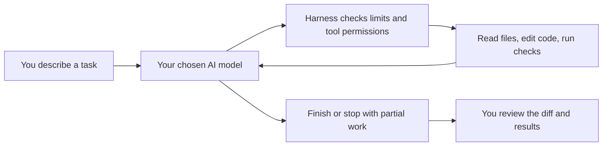
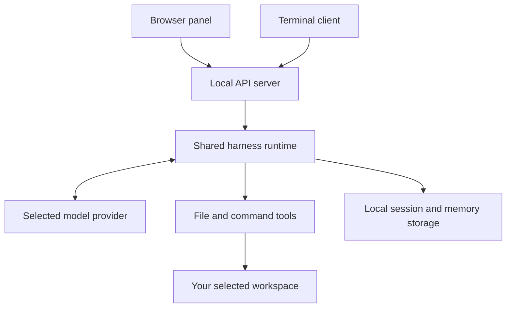

# agent-harness

**A local-first coding assistant for working with local and affordable AI models.**

Give it a small coding task, let it read and edit your files, then review the changes
and test results in your browser or terminal. You choose the model and set limits
on time, tokens and tool use.

[](https://github.com/jorj-pineda/agent-harness/actions/workflows/ci.yml)

[Try it](#try-it-locally) · [See the interface](#local-agent-panel) ·
[Full walkthrough](demo.md) · [Technical reference](old_README.md)

## What can I do with it?

- **Ask about your code.** Use an inspection-only session to explore a repository without giving the model editing tools.
- **Work on a small change.** Ask for a focused bugfix, feature or refactor, with a project check configured for the task.
- **See what happened.** Inspect tool calls, changed files, diffs, check results and why a run stopped.
- **Come back to your work.** Review saved runs and use explicit, guarded continuation or eligible single-file reversal when needed.

It works with Ollama, OpenAI, Anthropic and compatible chat endpoints. Local coding
needs no embedding model or document database. There is no required premium-model
supervisor or automatic paid fallback. Hosted providers can incur charges.

**Status: experimental.** The tools and recovery workflows have extensive offline
checks, but reliable unattended coding is not established. Start with a disposable
copy, give it a bounded task, and review its work. See the
[current assessment](RELEASE_READINESS.md) for measured results and limitations.

## Local agent panel


*An earlier panel screenshot from a scripted demo: the interface, file edits and
pytest run are real; the AI responses are canned. It illustrates the workflow,
not current model performance. The UI has evolved since this capture. The old
confidence badge is a legacy heuristic, not a probability that a fix is correct.*

## How it works



The model proposes actions. The harness controls which tools it can call, applies
configured limits and records the outcome. A passing project check is useful
execution evidence; you still need to judge whether the change solves your task.

## Try it locally

You'll need **Python 3.11+**, **[uv](https://docs.astral.sh/uv/)**, and a configured
model that supports tool calls. This example uses an existing local Ollama service
with **`gemma4:12b` already installed**. Choose a model your machine can run; this
example does not download or start a model service.

### 1. Install the project

```sh
git clone https://github.com/jorj-pineda/agent-harness.git
cd agent-harness
uv sync --extra dev
```

The development dependencies include pytest for the sample task. For packaged
installation details, see [installation notes](WHEEL_INSTALLATION.md).

### 2. Start the app

In the project directory, run:

```sh
DEFAULT_PROVIDER=ollama OLLAMA_MODEL=gemma4:12b \
OLLAMA_NUM_CTX=16384 OLLAMA_THINK=false \
MAX_CONTEXT_TOKENS=16000 MAX_TOTAL_TOKENS_PER_TURN=32000 \
MAX_COMPLETION_TOKENS_PER_TURN=4096 MAX_TOOL_CALLS_PER_TURN=12 \
MAX_TURN_WALL_SECONDS=150 REQUEST_TIMEOUT_SECONDS=180 \
REQUIRE_VERIFICATION_BEFORE_FINISH=true \
PROJECT_CHECK_ARGV='["python","-m","pytest","-q","test_calc.py"]' \
uv run agent-harness serve
```

These are example limits, not optimal settings for every model. Token limits use
estimates; setup, review and cleanup mean the time limit is not a hard return
deadline. The check command above is for the sample below—change it when working
on another project. Keep provider credentials in local configuration, out of Git.

### 3. Make a disposable sample workspace

In a second terminal, from the same project directory:

```sh
task_workspace="$(mktemp -d /tmp/agent-harness-demo.XXXXXX)"
cp tests/fixtures/tiny_repo/calc.py tests/fixtures/tiny_repo/test_calc.py "$task_workspace/"
echo "$task_workspace"
```

Open **http://127.0.0.1:8000/**. Enter the printed absolute path as the workspace,
choose `ollama`, and select **New session**. Send:

> Fix divide in calc.py so the failing divide test passes. Preserve add and run the configured check.

Review the tool activity and results. The model may finish, fail a check or stop
at a limit; inspect the actual changes before accepting them.

Prefer the terminal? Use the same workspace in the second terminal:

```sh
uv run agent-harness chat --user-id demo-user --provider ollama \
  --workspace "$task_workspace"
```

The browser and terminal use the same server. Read the [full walkthrough](demo.md)
for saved runs, cancellation, optional checkpoints and recovery.

## What runs where?



The app server listens on loopback by default. Repository commands run with your
machine's permissions: path checks and command allowlists are **not a sandbox**.
Use trusted repositories. Saved history is review-only by default; continuation
and reversal require explicit actions and have scoped preservation checks.

## Learn more

| I want to… | Read this |
|---|---|
| Follow a complete local workflow | [Demo and troubleshooting](demo.md) |
| Configure providers, profiles, budgets or recovery | [Detailed technical reference](old_README.md) |
| Understand installation and wheel support | [Installation notes](WHEEL_INSTALLATION.md) |
| Understand the actual model results | [Recorded evaluations](evals/BASELINES.md) |
| Run real-task evaluations | [Evaluation guide](evals/real_tasks/README.md) |
| See what's complete and what's next | [Roadmap](roadmap.md) |
| Contribute code | [Development instructions](AGENTS.md) |

The previous README is preserved in [old_README.md](old_README.md). It contains
advanced configuration and historical detail; follow the current roadmap and
release assessment when interpreting older claims.
